# Wondful 最近改动、效果与问题记录

整理日期：2026-11-15。分支：`fix/wondful-render-review`。

**这是开发与效果复盘快照，当前视觉验收未通过，不是正式发布。** 用户最终反馈为“车漆还是有点假”“车身上细节少了很多”。paint V2 曾被助手按单张车漆表现判断通过；该局部判断已被后续用户反馈否定。本记录按最新反馈标注，不将流程成功、单元测试通过当作视觉通过。

## 本次保存的代码

保存原工作分支 `codex/replica-polish-camera-sync`（基线 `4c5d0ff`）上最近未提交的插件、测试与 E2E 工具改动，不夹带另一个 checkout 的 PC 反馈修复。

- **原图编辑流程**：已验证的原图、当前相机实际模型投影、产品身份图及身份裁切，经过参考分析和最终润色，再生成一张新图。保留图像职责、来源哈希和相机/模型/材质过期检查。
- **生图接口兼容**：source-only 请求改走 `chatgpt.com/backend-api/codex/images/edits`，使用独立 `images`/`prompt` 请求与 JSON 图片响应；其他流程保留原有路径。保留请求失败证据，不靠自动重试掩盖失败。
- **自然融合**：当前 REFERENCE source-only 导出保留适配后的 AI 图，不再以原生整车覆盖。报告明确 `native_replacement=false`、`geometry_audit=false`、`detail_review_required=true`、`material_plan_applied=false`。
- **车漆策略 V1/V2**：基础色与预览质感分离，去掉从未解析的材质默认值推导“半哑光”；保留模型绿色/黑色，光泽与场景反射另行推断。V2 又限制了旧车漆面及无场景依据的图形反光。提示词策略版本提升至 7。
- **对应回归及流程调整**：包括原图输入、投影、材质计划、润色响应、请求结构、参考职责、UI/工作流及相关现有测试的同步。
- **历史失败实验**：保留 `native_product_finish.py` 与配套测试供复盘；它们不是当前自然融合分支的生效完成步骤，不能据此声称当前输出经过原生整车修复。

本次上传本身没有再修改实现，没有生成新图、安装插件、保存或操作用户 Blender 工程。

## 效果对照

图片均为原文件的逐字节副本，未调色、锐化、重绘或放大。原始输出与最终导出因画布适配可能具有不同尺寸。完整尺寸、来源与 SHA-256 见 [image-manifest.json](image-manifest.json)。

| 阶段 | AI 原始图 | 插件最终图 | 结论 |
|---|---|---|---|
| 更早的原生整车合成基线 | 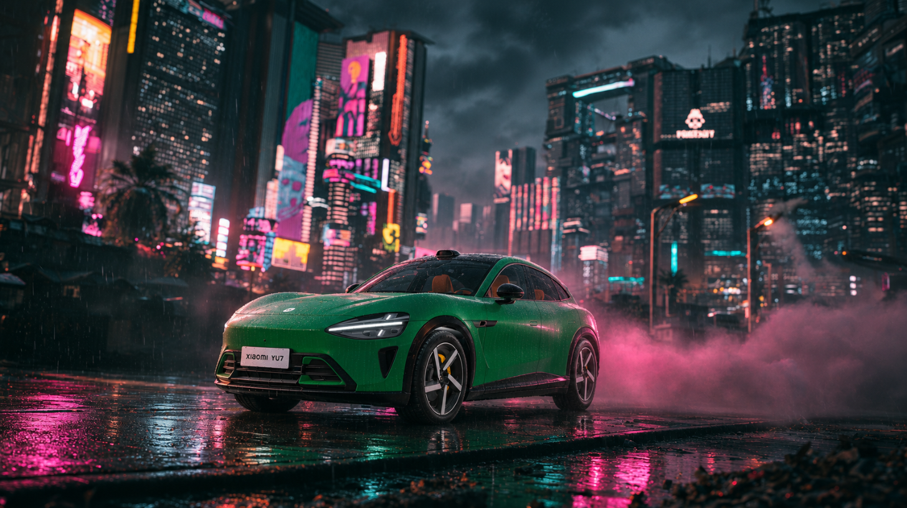 | 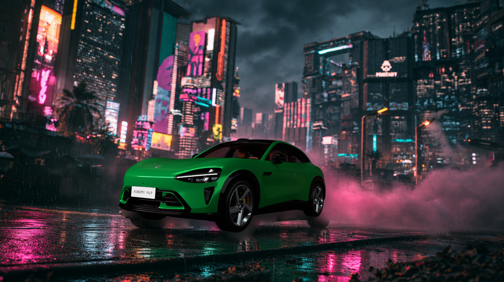 | 视觉失败：车身偏平、反射连续性和轮胎接地不足；不能用 alpha/结构指标代替视觉验收。 |
| 修复接口后的霓虹新图 |  | 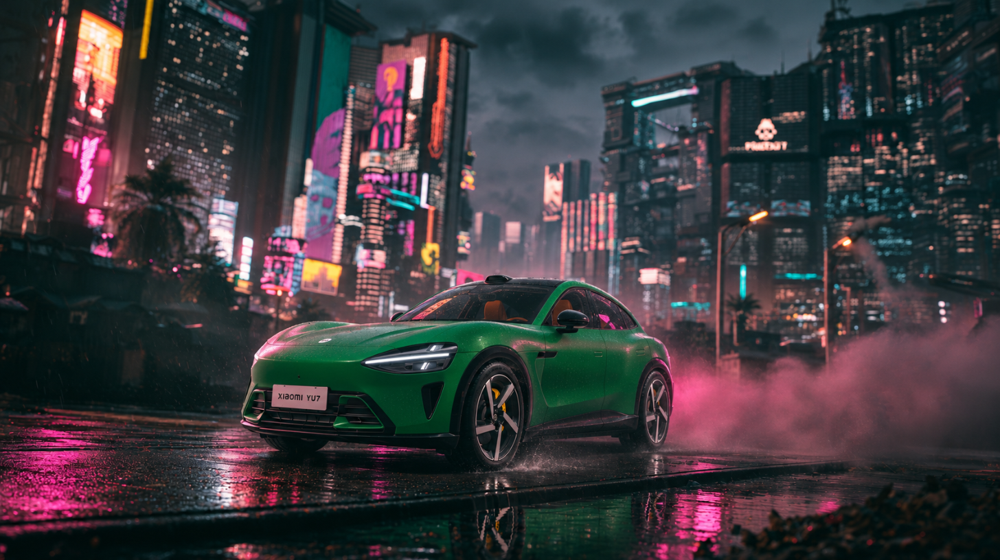 | 真实新调用和导出完成；当时目视认为融合改善，车牌、灯内、轮辐等精细身份与几何未认证。 |
| 换沙漠场景的新图 | 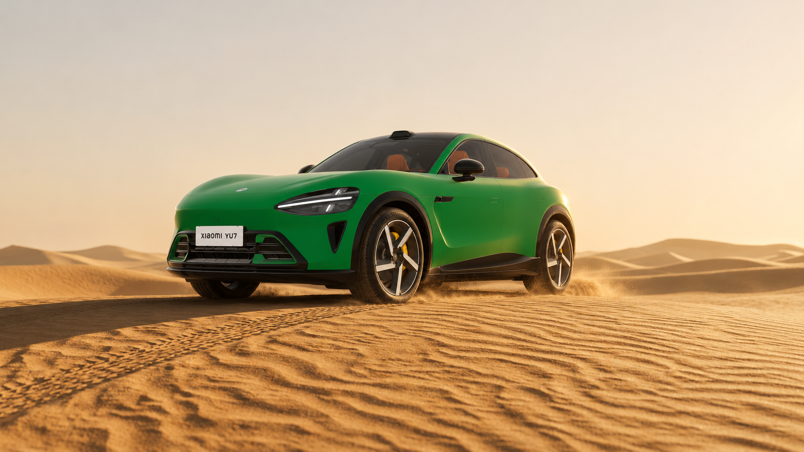 | 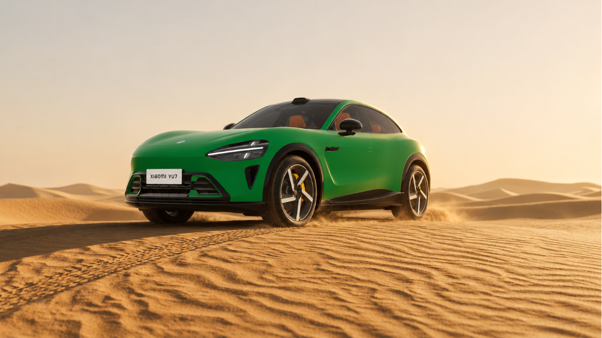 | 视觉失败：车漆仍偏 CG；车的位置偏高、尺寸偏大。 |
| 车漆 V1 | 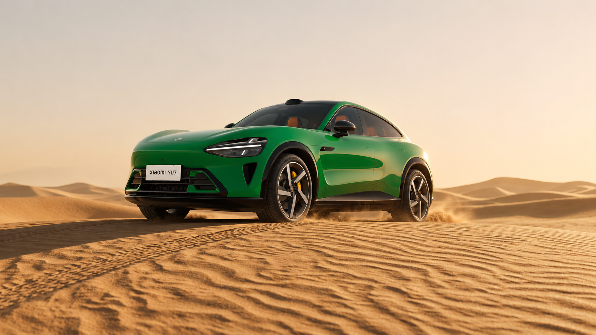 | 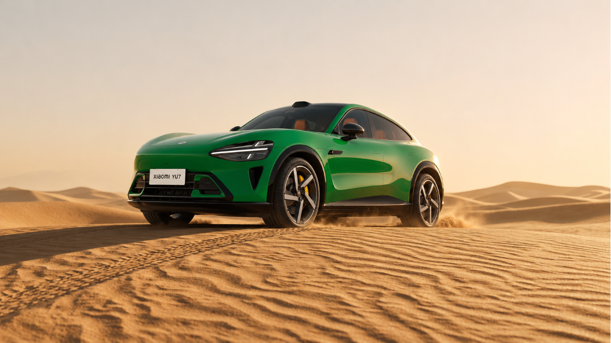 | 视觉失败：门板反光仍有明显图形色带/CG 感。 |
| 车漆 V2 | 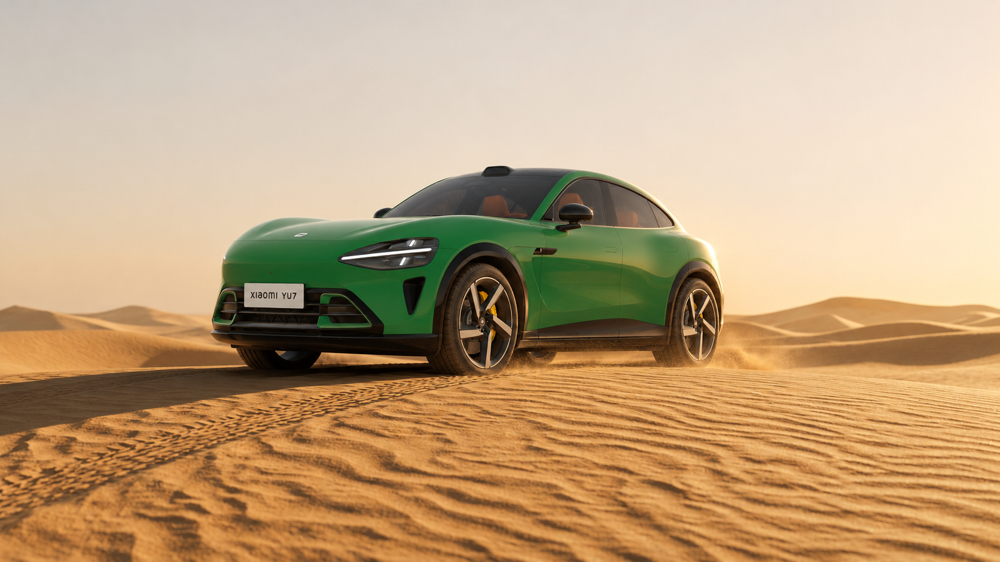 | 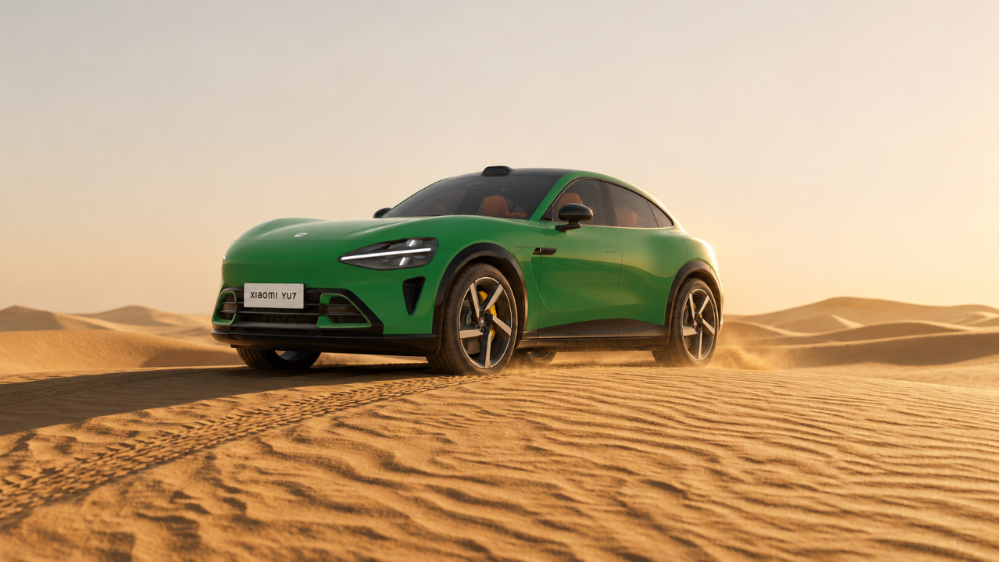 | **用户拒绝**：漆面仍假、车身细节减少。历史目录名 `v2-accepted` 不代表当前验收结果。 |

更早的原生合成基线是已有真实输出，不属于后续四张新图；2026-11-08 的自然融合本地回放复用了该已有 AI 图，零 provider 调用，只验证输出处理和状态保持，不能当作新生图或完整线上测试。随后霓虹、沙漠、V1、V2 才是四次实际返回的新图。

## 已遇到的问题

| 问题 | 证据与处理 | 当前状态 |
|---|---|---|
| 复用旧图被误当完整验证 | 明确区分既有图回放、新投影、两次实际文字分析、一次实际生图及最终导出。 | 记录与测试口径已区分；回放不能证明线上可用。 |
| TLS/连接中断 | 初次图片请求连接中断、没有图片，不能据此判断是否计费；不自动重试。 | 后续独立授权的新请求成功；本次上传没有线上复测。 |
| 旧 Responses 生图参数不兼容 | 默认/显式 `complexity` 候选均未得到有效图；最终改用独立图片编辑请求。 | 当前 source-only 适配有后续真实返回与离线覆盖；接口仍需随服务变化维护。 |
| 请求 high，实际返回 medium | 霓虹、沙漠及车漆测试记录实际返回 medium；服务没有报告实际图像模型。 | 未解决；不能把请求参数写成实际生成质量，也未靠猜测参数修复。 |
| 测试工程与参考画布比例不符 | 首次沙漠预检在上传前阻止执行；随后只调整隔离测试副本输出尺寸。 | 预检生效；原始工程、相机与产品保持不变。 |
| 原生整车覆盖损伤融合 | 背景补洞/近似打光使反射和轮胎接地退化。 | 当前自然融合路径取消整车覆盖；失败实验保留用于复盘。 |
| 车漆被错误描述成半哑光 | Roughness/Metallic 连接节点未解析，却使用默认粗糙度总结漆面。 | source-only 改为只锁基础色，不从预览默认值推断漆面；真实感仍未通过。 |
| 旧车反光或人工色带影响新车 | V1 强图形反射；V2 收紧证据规则后仍被用户拒绝。 | 未解决，不能继续宣称已修好。 |
| 车辆位置与比例向原图旧车偏移 | 沙漠投影 alpha bbox `[301,353,828,594]`；输出车 bbox 人工估计 `[264,208,918,483]`。后者不是分割或 IoU 测量。 | 未通过几何验收。 |
| 小零件层次变弱 | 门缝、把手、灯内组件、轮胎/轮圈/刹车及风道趋于平滑。 | 当前自然融合只标记人工待验，没有接入正式版的局部检测/修复闭环。 |

后续自然融合测试阶段共记录 7 次图片请求尝试、4 张实际返回图片；包括此前 3 次失败请求，不含更早的原生合成基线。没有将失败请求伪记成返回图片，也不据此推断实际扣费。

## 本地模型细节核查

原 1280×720 投影中的车宽约 527 像素。重新原生渲染 2560×1440 后，alpha bbox 为 `[603,706,1655,1187]`，车宽 1052 像素。下面两张是新原生渲染的未重采样局部，不是放大旧低清投影。

| 车头、前轮与刹车 | 门缝、把手与后轮 |
|---|---|
| 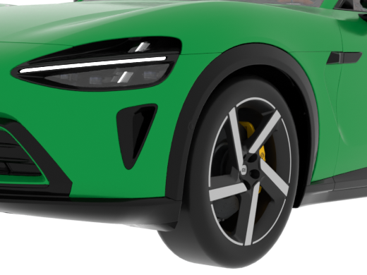 | 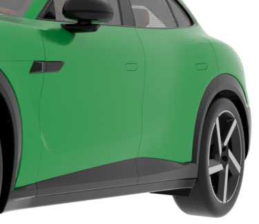 |

[原始同机位投影](images/07-desert-model-projection.png) · [完整 2 倍原生渲染](images/12-native-model-2x.png)

模型投影已有门缝、把手轮廓、灯内组件、轮圈中心件及刹车盘/卡钳，但均匀照明下层次已偏平，AI 又进一步简化。不能将所有损失归因于 AI，也不能从现有图断言模型完全缺少这些结构。此次本地渲染的工程 SHA、相机/模型/材质状态摘要前后一致，输出设置恢复，零 AI 请求。保存了这些可移植结果于 [evidence-summary.json](evidence-summary.json)。

## 与正式版 1.2.4 的对照

已核对 [1.2.4 正式发布](https://github.com/tiandaoyouchang-png/wondful-ai-renderer/releases/tag/v1.2.4) 和 [更新清单](https://raw.githubusercontent.com/tiandaoyouchang-png/wondful-ai-renderer/main/releases/latest.json)。线上与本地发布包一致，SHA-256 为 `88580c1c8306d3ea50bc12968ad6ac949abda2cbf4bc5a5835bb204b97506f2b`。1.0.0 是首次正式版，1.2.4 是此次核实到的后续正式版，不混同于本实验快照。

| 机制 | 正式版 | 当前 REFERENCE 实验路径 |
|---|---|---|
| 主要模型画布 | `render_clay_base`：临时地面、太阳光、天空渐变及两条长柔光灯带；模型位置/曲面与地面接触可见。 | `product_projection.capture` 使用 `render_detail_pass` 的均匀白光、透明背景投影，作为原图编辑的第二张参考。 |
| 广告级漆面 | `ENV_DESCRIBE_PROMPT` 单列车身质感，提取清漆、天空/环境倒影、高光和暗部过渡；简单路径将环境转为文字，不以环境图主导构图。 | 原图本身是编辑画布；V2 明确排除旧车漆面及高光/反射形状作为依据，主要由身份图与可见环境推断漆面。 |
| 小部件修复 | `detail_refine`：逐块结构检查，只修失败区域，贴回前检查对齐、结构改善、平淡度和接缝。 | `_apply_source_detail_repair` 实际保留适配后 AI 像素，只记录待人工验收，绕过常规局部修复步骤。 |
| 回贴边界 | `detail_paste.region_class` 排除车漆、车身、轮胎、玻璃、后视镜和内饰；仅允许受限小部件。 | 不做回贴；也不能因此声称细节已还原。 |

正式版允许有限的局部图片修复调用，这些属于额外请求。此前每轮只有一次新图的授权，不能在未获批准时悄悄恢复自动多次生图。

**结论与待办：** 应对照正式实现接回合适的模型画布、漆面质感提取以及局部检查/修复，再做受控比较。目前只完成了对照，尚未实施接回；没有证据证明单独换同色实拍就能解决全部问题。后续车漆、几何、灯/轮组/标识应分项验收。

## 实拍与专业渲染参考

以下只保留来源链接；下载照片没有随分支上传，也没有作为新资产送往生成服务。

- [新出行 YU7 原创实拍](https://m.xchuxing.com/article/149992)：零件分界、风道与车轮。银色实拍不能直接证明宝石绿涂装响应。
- [汽车之家 YU7 绿色近摄](https://www.autohome.com.cn/cars/imgs-7793-68936-12-x/12368301.html)：灯罩层次、板件间隙与不同材料响应。近摄尺度不能直接当整车远景验收尺度。
- [George F. Williams — Supercars in the Sand](https://gfwilliams.net/portfolio/supercars-in-the-sand/)：沙漠摄影的光线、环境色与接地。
- [Emir Şafak — BMW M4 / Chaos Corona](https://www.chaos.com/gallery/bmw-m4)：专业渲染的零件与材质分离。
- [小米官方 YU7 说明](https://www.mi.com/ng/discover/article?id=4958)：宝石绿的金属底层与半透明珠光层，仅适用于匹配的涂装。
- [Autodesk Arnold Car Paint](https://help.autodesk.com/cloudhelp/ENU/AR-Core/files/ac-shading/ac-surface-shaders/arnold_core_ac_car_paint_html.html)：分层车漆响应。

## 验证范围

历史车漆候选相关离线检查为 108 项通过，但不能证明漆面真实或用户接受。此次上传前重新运行的完整离线回归、文件核查和快照清单见 [verification.json](verification.json)。没有新增线上生成、视觉通过或正式发布的声明。

2026-11-15 的全量复核**未通过**：正常启动独立 Blender 后共运行 **1123 项，8 项失败、6 项错误、15 项跳过**，耗时 144.385 秒。当前失败集中在：

- `test_123_hull_placeholder`、`test_123_scene_blockout`：测试预期的 `Wondful 场景粗模` 集合不存在，后续读取报错。尚未进一步区分生产回归和旧测试夹具/固定集合名契约不一致。
- `test_123_sb_progress`：场景构建被“请先添加有效的产品身份参考图”阻止，后续阶段记录缺失，产生多个衍生错误。需要对齐测试输入和当前产品身份要求。
- `test_123_updater`：隔离测试中的重复插件副本识别/删除及完成提示共 3 个内部检查不符合预期；不能据其他更新检查成功宣称该 E2E 通过。

首次在受限环境运行时独立 Blender 启动崩溃、缺少输出报告，结果为 1107 项、3 项失败/19 项错误/15 项跳过；它没有替代上述正常启动后的最终结果。完整日志保留本地，只上传不含凭据/临时路径的摘要与测试标识。本次按用户要求保存现状和问题，未为使测试变绿而另行改写实现或断言。
